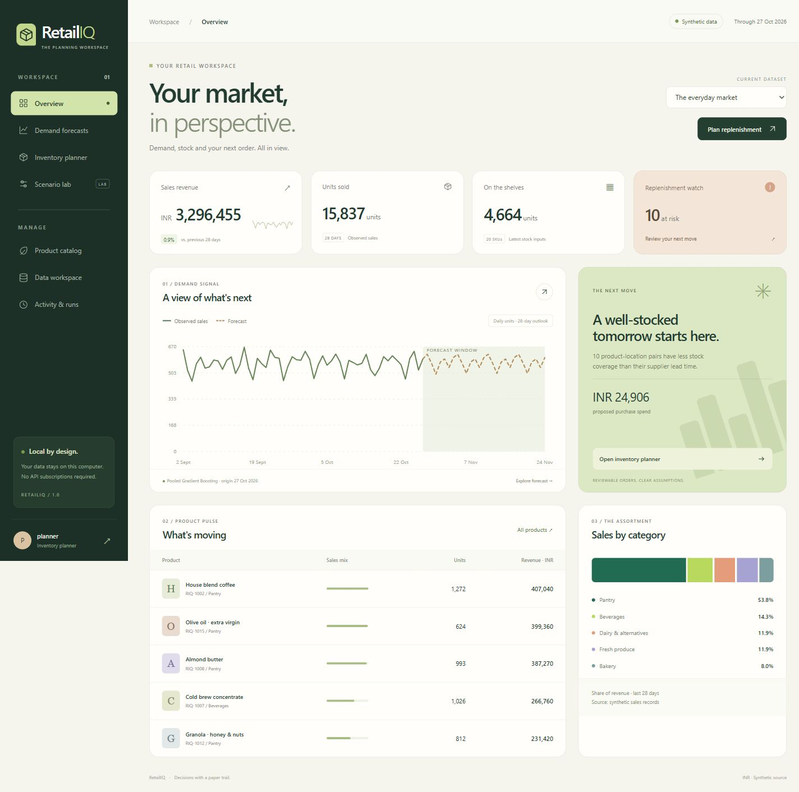

# RetailIQ

AI-powered retail sales forecasting and inventory planning, built with Python and Django. Runs locally without paid APIs, a hosted database, a GPU, or a frontend build service.

Repository: [Dilep01/retailiq](https://github.com/Dilep01/retailiq). Published privately for account-owner review.



RetailIQ follows sales data through validation, chronological forecasting, replenishment calculations, and controlled inventory simulation. It is a single-planner local application and a portfolio project. It has not been validated in a live retail operation.

## Run on Windows

Use Python 3.12. From PowerShell in this folder:

```powershell
.\scripts\setup.ps1
.\scripts\start.ps1
```

If Python discovery needs help, use `scripts\setup.ps1 -Python 'C:\path\to\python.exe'`.

Open **http://127.0.0.1:8877/**. Your automatically generated local login is saved in **`.runtime/review_credentials.txt`**. That file is private and ignored by Git. You can also create a separate account with `.venv\Scripts\python.exe manage.py createsuperuser`.

Setup installs locked packages, applies migrations, creates a 20-product/730-day synthetic demo, evaluates forecasts, prepares a constrained plan and a simulation, and collects static files. Initial setup needs internet for packages. Normal demo use needs no internet. The optional UCI import needs a separate download.

Start launches a localhost-only Waitress server and one background worker. Stop both with `scripts\stop.ps1`. Use `scripts\start.ps1 -Port 8878` if the default port is occupied. Logs live in `.runtime/`.

For development: `.venv\Scripts\python.exe manage.py runserver 127.0.0.1:8877`, with `.venv\Scripts\python.exe manage.py run_worker` in another terminal. Do not run two servers on the same port.

## What works

- Custom responsive interface: dark green navigation, warm workspace, SVG charts, a product collection, planning panels and scenario comparisons. No remote fonts, CDN requests, or JavaScript build step.
- Session login and protected business pages; Django admin is available for separately created staff accounts.
- UTF-8 daily-sales CSV validation, preview, row errors, atomic commit, checksum idempotency and immutable dataset selection.
- Source, currency, quality flags, dates and inventory assumptions remain visible.
- Sales dashboard, category revenue, searchable product catalog, product history and stock editing.
- Frozen 28-day seasonal-naive and pooled direct-horizon gradient-boosting forecasts.
- Three chronological validation windows, separate historical holdout, baseline comparisons, per-series errors and coverage/fallback reporting.
- Approximate daily residual-based P10/P90 intervals with empirical coverage, width and pinball-loss evaluation.
- Periodic-review order-up-to planning, safety-stock approximation, pack/MOQ rules, budget allocation, SciPy integer allocation and stale-input detection.
- Matched lost-sales simulations comparing fixed, seasonal and ML policies, with budget and delivery-delay scenarios.
- Durable database job queue, one-worker OS lock, interrupted-job detection, audit trail and CSV exports.
- Consistent SQLite backup command, dependency locks, tests and a GitHub Actions workflow.

## Architecture

`Browser → Django views/forms → application services → SQLite + local model artifacts`

Long operations run in `manage.py run_worker`, outside HTTP requests. `retailiq/services/` contains independent data, forecasting, inventory and simulation modules. `retailiq/models.py` holds operational records; `templates/` and `static/` hold the UI. The application deliberately uses one Django app with focused service modules instead of many mostly empty apps. See [architecture decisions](docs/ARCHITECTURE.md).

## Data

The included seeded demo is synthetic. Its stock and supplier parameters are independent scenario inputs; its historical sales assume availability. The simulation generates independent latent demand paths and reveals only fulfilled sales to policies.

Optional public-data workflow:

```powershell
.\.venv\Scripts\python.exe manage.py import_uci --download --products 20
# Use the dataset ID printed above:
.\.venv\Scripts\python.exe manage.py train_forecasts --dataset 2
```

The UCI adapter excludes cancellations/returns from the gross-positive-sales target, excludes non-product codes, selects products using the first 180 days only, and assumes a complete transaction export when constructing zero-sales days. It removes the incomplete final export day. Customer identifiers are not persisted. See [data card](docs/DATA_CARD.md) and [UCI attribution](https://archive.ics.uci.edu/dataset/352/online+retail).

User CSV columns: `date,sku,units_sold,unit_price`; optional `name,category,location,observation_status`. Download a template from Data workspace. Unknown calendar dates are not silently filled with zeros. Sales-only uploads require separate stock/cost inputs before ordering or simulation.

## Results and limits

[Measured evaluation](docs/EVALUATION.md) contains the actual synthetic and public-data results, date cutoffs, runtime, interval coverage and simulation outcomes. [Machine-readable evidence](docs/evidence/evaluation.json) preserves manifests and parameters.

The public wholesale-sales dataset remains difficult to forecast; improvement over a baseline does not imply good absolute accuracy. Inventory results are simulated, with assumed procurement costs and service penalties. No live savings or stockout reductions have been established.

Inventory v1 uses aggregate on-order stock, assumed to arrive before needed. It has no dated operational purchase-order ledger, supplier integration, perishability/spoilage model, or automatic order placement. Normal safety stock assumes fixed lead time and independent variability. Daily intervals cannot be summed into calibrated cumulative-demand quantiles. The MILP optimizes an explicit linear priority score, not guaranteed long-run profit. Equal simulation budget shares can disadvantage expensive products. These are documented boundaries, not hidden capabilities.

## Verify and reproduce

```powershell
.\.venv\Scripts\python.exe -m pip install -r requirements-dev.lock
.\scripts\verify.ps1
.\.venv\Scripts\python.exe manage.py export_evidence
.\.venv\Scripts\python.exe manage.py backup_workspace
```

Tests cover data integrity, future-data perturbation, training cutoffs, forecasting, budget feasibility, delivery timing, inventory conservation, replay reproducibility, protected pages, CSRF, exports, the public-data adapter and queued jobs. See [verification record](docs/VERIFICATION.md) for browser checks and recovery checks. [GitHub Actions](https://github.com/Dilep01/retailiq/actions) passed after publication; inspect it for the latest branch status.

## Review guide

Start at Overview, inspect Demand forecasts, change an inventory budget, inspect an explanation, export the proposal, then compare policies in Scenario lab. Use the dataset selector on Overview to inspect the UCI experiment. [User guide](docs/USER_GUIDE.md), [local deployment](docs/LOCAL_DEPLOYMENT.md), [model card](docs/MODEL_CARD.md), [portfolio/resume wording](docs/PRESENTATION.md), and [phase closeout](docs/IMPLEMENTATION_STATUS.md) provide the details.

[Watch the 25-second captured-screen walkthrough](docs/demos/retailiq-walkthrough.mp4). It uses actual synthetic-demo screenshots and is labeled as a visual walkthrough rather than a continuous live recording.

Code: MIT. UCI data: CC BY 4.0 with separate attribution. Third-party Python packages retain their own licenses.
