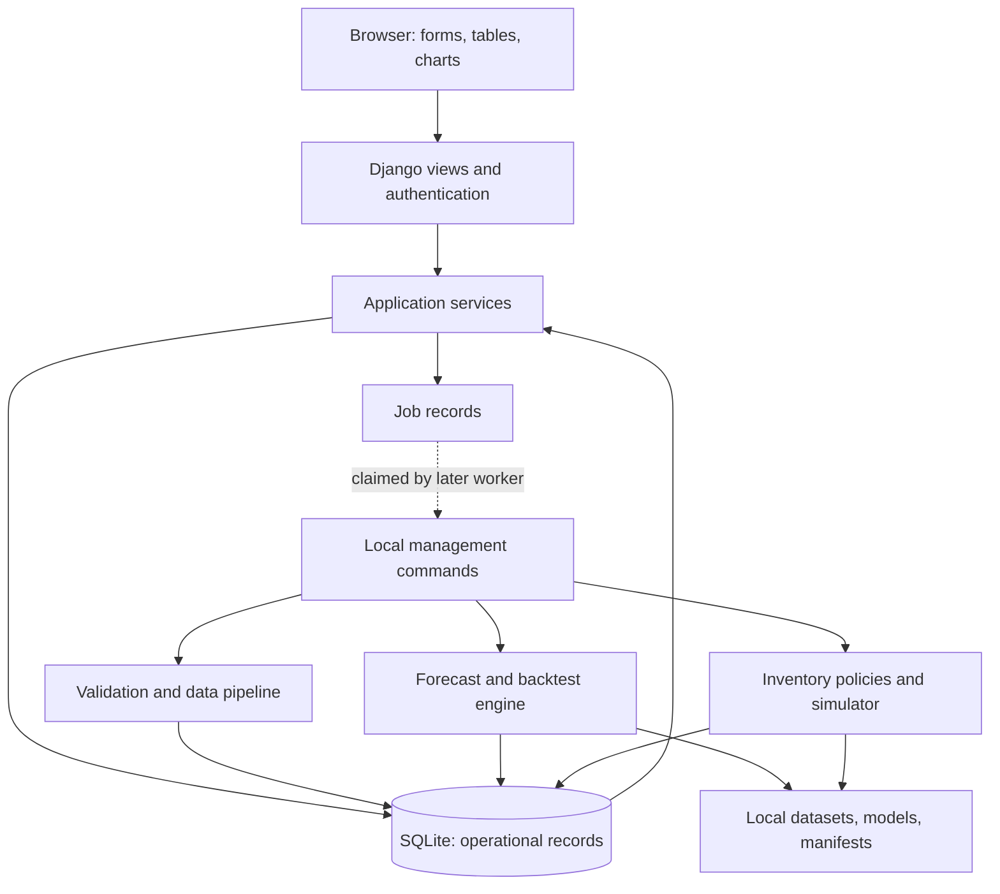

# RetailIQ implementation blueprint

Prepared 28 October 2026. Status: proposed implementation; no application has been built or benchmarked yet.

RetailIQ — AI-Powered Retail Demand Forecasting & Inventory Optimization Platform

## 1. Purpose and intended result

Build a local Python web application that helps a retail inventory planner answer:

- What are we likely to sell over the next 7, 14, and 28 days?
- Which products might run out before replenishment arrives?
- How many units should we order, given lead times, pack sizes, and available money?
- How do alternative inventory policies perform under the same simulated demand?

The complete workflow is: import data, inspect quality, explore sales, produce forecasts, calculate replenishment recommendations, compare scenarios, and export a reviewable order proposal.

The AI component is forecasting with statistical and machine-learning models. A chatbot or language model is not required. The initial audience is one planner operating one local installation, not multiple businesses sharing a hosted service. A location represents a store or warehouse; a SKU is a distinct product identifier.

Start with 20 SKUs, one location, and one year of synthetic daily data. Expand toward 50 SKUs, two locations, and two years only after the full workflow works. These are proposed workload sizes, not demonstrated capacity.

### Release scope

**MVP:** local login, CSV imports, quality report, sales dashboard, product details, seasonal-naive forecasts, simple replenishment rules, recommendation explanation, CSV export, and automated core tests.

**Portfolio v1:** public-data adapter, chronological model comparison, machine-learning candidate, prediction intervals, reproducible inventory simulation, budget constraints, job tracking, audit history, and documented local release.

**Advanced extensions:** aggregate-demand uncertainty, intermittent-demand models, mixed-integer allocation, PostgreSQL, a durable local worker, hierarchical forecasting, and monitoring. Add these selectively after v1.

Keep supplier integrations, payments, automatic purchasing, cloud infrastructure, customer accounts, mobile applications, and real-time point-of-sale integrations outside the initial scope.

## 2. Zero-budget stack and resource plan

Zero budget means no paid software subscriptions, paid APIs, hosted databases, rented servers, or GPU services. It assumes an existing computer, electricity, and internet access for initial downloads. Once dependencies, assets, and data are downloaded, ordinary local use should work offline.

| Layer | Recommended choice | Reason and boundary |
| --- | --- | --- |
| Runtime | Python 3.12, latest supported patch | Conservative starting point; validate the complete dependency set before locking it. |
| Web framework | Django 5.2 LTS, latest supported patch | Templates, forms, ORM, migrations, authentication, and admin in one framework. |
| Browser UI | Django templates, HTML, CSS, Bootstrap, small JavaScript modules | A full web application without requiring Node or React. Vendor assets locally. |
| Charts | Chart.js; accessible tables alongside charts | Browser interaction without a paid chart service. |
| Operational database | SQLite | Appropriate starting point for one local user and low write concurrency. |
| Data processing | pandas, NumPy, openpyxl for the UCI adapter | Daily aggregation, validation, spreadsheet input conversion. |
| Forecasts | scikit-learn; optional statsmodels | Strong baselines, a manageable ML candidate, and optional statistical comparisons. |
| Optimization | Plain Python first; SciPy MILP later | Explainable rules before constrained mathematical optimization. |
| Tests and quality | pytest, pytest-django, coverage, Ruff; Playwright later | Business logic, web/database integration, and selected browser flows. |
| Local release server | Waitress plus WhiteNoise | Windows-compatible WSGI serving with bundled static assets. |
| Source and evidence | Git, GitHub, Markdown, screenshots, recorded demo | Reproducible implementation and public presentation. |

Django is open source under the BSD license; Django 5.2 remains listed as an LTS series. Python 3.12 is supported by Django 5.2. Choose exact package versions during setup, install them in a clean virtual environment, run smoke checks, then commit a dependency lock with exact resolved versions. Do not install every optional package at once. [Django releases](https://www.djangoproject.com/download/), [compatibility](https://docs.djangoproject.com/en/5.2/faq/install/).

Planning estimate: 8 GB RAM is a useful starting point for the small workload; 16 GB gives more headroom. No GPU is planned. These are estimates to verify on the actual computer. With less memory, use fewer SKUs, shorter history, bounded jobs, and fewer model candidates. Avoid expanding the dataset into all horizons in memory without measuring its size.

## 3. Data strategy and contracts

### Track A: reproducible synthetic retail

Write a seeded generator for products, locations, daily demand, prices, opening stock, supplier lead times, and receipts. Include weekly seasonality, trend, intermittent purchases, demand spikes, slow sellers, price changes, and a few known data-quality errors in separate test files.

Preserve two different series:

1. **Latent demand:** how many units customers wanted, visible only to the simulation evaluator.
2. **Observed sales:** units actually sold after inventory availability limits sales, visible to the ordinary application.

Never feed hidden future demand or future supplier outcomes into forecasting features. Synthetic categories, promotions, costs, supplier data, and inventory must remain marked as synthetic in the database, screens, and reports. Use separate generator seeds for development and final evaluation; results on the generator do not establish real-world effectiveness.

### Track B: public transaction data

Use the UCI Online Retail dataset as the first external-data adapter. Its source describes 541,909 transaction records from 1 December 2010 through 9 December 2011 for a UK online retailer, with many wholesale customers. It is available under CC BY 4.0; preserve attribution and document transformations. Its fields include invoice, product, quantity, time, price, customer ID, and country. [UCI dataset and license](https://archive.ics.uci.edu/dataset/352/online+retail).

Treat this as historical online-sales forecasting, not evidence about a present-day supermarket. It lacks stock snapshots, procurement costs, replenishment lead times, and reliable observed lost demand. Do not reinterpret countries as stores. Use one logical online location. Exclude customer identifiers from application exports and public samples because this project does not need customer-level analysis. Keep the source currency as GBP; do not relabel it as INR.

Track cancellations and returns separately. Forecast gross positive units sold; show net revenue separately when appropriate. Separate delivery/service codes from physical products through a documented mapping. Do not clip unusual orders automatically: wholesale orders can be legitimate. Inspect blanks and anomalies even when source metadata suggests complete data.

Inventory simulation using this dataset is a sales-replay scenario with assumed stock and supplier parameters. It cannot measure actual historical stockout reduction. About one year of history also provides limited evidence for annual seasonality.

### Initial CSV schemas

- `products.csv`: `sku`, `name`, `category`, `unit_cost`, `selling_price`, `pack_size`, `minimum_order_qty`, `active_from`, optional `active_to`.
- `locations.csv`: `location_id`, `name`.
- `daily_sales.csv`: `date`, `sku`, `location_id`, `units_sold`, `unit_price`, `observation_status`.
- `inventory.csv`: `as_of_date`, `sku`, `location_id`, `on_hand`, `allocated`, `on_order`.
- `suppliers.csv`: `supplier_id`, `name`.
- `supplier_products.csv`: `supplier_id`, `sku`, `lead_time_days`, optional order constraints.
- Later: `purchase_order_lines.csv` with quantity, remaining quantity, expected receipt date, received quantity, and status. This replaces aggregate on-order values for time-aware simulation.

Store `source_kind`, source reference, import batch, and assumption flags alongside imported entities. Do not require fabricated costs to import sales-only data: missing inventory inputs disable the relevant recommendation and explain what is missing.

Use ISO dates and explicit source timezone handling before daily aggregation. Use decimal currency values, integer physical-unit quantities, and explicit currency codes. The UCI XLSX adapter converts source transactions into the canonical format; ordinary UI imports begin with CSV.

### Validation and import behavior

Validate columns, types, product/location references, date ranges, nonnegative sales and inventory values, positive pack sizes, lead times, and consistent currencies. Keep negative returns in their own event type. Reject malformed rows with row numbers and reasons; preview counts before committing an atomic batch.

Use file checksums and batch identifiers to make repeated imports idempotent. Do not blindly remove identical transaction rows: two similar lines can represent separate purchases. For daily aggregates, enforce uniqueness on source snapshot, date, SKU, and location; define explicit replace-versus-reject behavior for overlaps.

Distinguish a known zero-sales day from a missing observation, store closure, product not yet active, and an incomplete export. Only fill zero where the source convention justifies it. Store imputation flags. Do not backfill future values into earlier missing dates. Mark suspected stockout-censored observations where inventory evidence exists; otherwise state that sales are only a proxy for demand.

## 4. Architecture

Use a modular monolith: one deployable Django application with separately testable Python modules.



Views validate requests and call services. Services coordinate business operations and database transactions. Forecast and inventory functions accept explicit inputs and return results without depending on browser requests. Put exploratory work in notebooks and executable business logic in source modules.

Keep model training outside web requests. Initially, a management command performs training and updates a database job record while the browser reads its status. A later worker can claim queued jobs transactionally. Do not present a working Run button until that worker exists. Training should not hold a long database write transaction; commit results after successful computation.

Each result must be traceable through dataset version, cutoff date, feature configuration, model version, dependency versions, random seed, code revision when available, policy parameters, and scenario ID. Invalidate cached results when an input changes. Publish completed runs atomically; failed runs must not replace the previous usable model.

### Proposed repository

```text
retailiq/
  manage.py
  pyproject.toml
  requirements.in
  requirements.lock
  requirements-dev.lock
  .env.example
  .gitignore
  README.md
  LICENSE
  config/
    settings/{base,development,local_release}.py
    urls.py
    wsgi.py
  apps/
    core/              # users, common utilities, jobs
    catalog/           # products, locations, suppliers
    ingestion/         # upload, validation, source adapters
    analytics/         # dashboards and historical summaries
    forecasting/       # runs, features, baselines, models, evaluation
    inventory/         # state, policies, recommendation audit
    simulation/        # daily events, scenarios, evaluation
    reports/           # exports
  templates/
  static/{css,js,vendor}/
  scripts/
  notebooks/
  tests/{unit,integration,e2e,fixtures}/
  data/{samples,raw,processed}/
  artifacts/{models,reports}/
  docs/{screenshots,decisions}/
  .github/workflows/ci.yml
```

This is the proposed layout, not files already created. Keep the existing long parent-folder name if desired. Use the valid Python package name `retailiq` or `config` internally, and quote the full Windows parent path because it contains `&`.

### Core records

| Record | Important fields and relationships |
| --- | --- |
| Product, Location | Stable SKU/location identifiers, attributes, active dates. |
| Supplier, SupplierProduct | Product sourcing, lead times, MOQ and pack constraints. |
| ImportBatch, DatasetVersion | File hash, source, validation status, date coverage, immutable version reference. |
| DailySales | Date, product, location, sold/returned units, sales value, observation flags. |
| InventorySnapshot | As-of date, on hand, allocated, imported on order. |
| PurchaseOrder, PurchaseOrderLine | Order status, product/location, quantities, promised and actual receipts. |
| InventoryMovement | Receipts, sales issues, returns, adjustments, timestamps and references. |
| ForecastRun, ForecastPoint | Origin, target date, model, point estimate, optional quantiles, dataset version. |
| ModelEvaluation | Cutoffs, model settings, metrics, series coverage, failure counts. |
| Policy, RecommendationRun, RecommendationLine | Inputs, target stock, proposed quantity, constraints, explanation. |
| Scenario, SimulationRun, SimulationDay | Demand path, initial state, policy, daily events and cost/service outcomes. |
| Job, AuditEvent | Queued/running/succeeded/failed status, timestamps, errors, actor and action. |

Snapshots are observations at a time; movements explain changes. Define reconciliation rules before mixing them. MVP may use snapshots alone. When the movement ledger is added, designate the inventory balance source of truth and test reconciliation so receipts are never counted twice.

Index frequent date/product/location filters. Prevent duplicate forecast points per run and target. Use foreign keys and database constraints for business invariants. Paginate tables and use bulk insertion for imports.

## 5. Forecasting design

### Start with clear baselines

1. Last observed day.
2. Seasonal naive: repeat the last observed seven-day pattern across the entire future horizon.
3. Trailing 7-day and 28-day mean.
4. Optional exponential smoothing for series with adequate history.

For a 28-day seasonal-naive forecast, do not accidentally read actual sales from the first forecast week to predict the second. Every prediction must be possible using the information available at its stated origin.

### First ML candidate

Use a bounded `HistGradientBoostingRegressor` experiment with lagged sales, trailing means and variability, recent zero-sales fraction, target weekday/month, product category, location, and forecast horizon. A pooled model can learn across products without training hundreds of separate estimators. Encode categorical identifiers consistently; do not treat arbitrary SKU numbers as meaningful quantities.

Start with a next-day model. For the full application, use a pooled direct-horizon design: at an end-of-day origin `t`, produce examples for `h=1..28`, target sales at `t+h`, and use only features available through `t` plus known target-date calendar features. Training examples are eligible only when their target date is on or before that fold's training cutoff. Keep the origin and target date in every feature row for auditing.

Future prices, promotions, weather, and competitor activity are unavailable unless a genuine future plan or forecast exists. Leave them out initially. An assumed promotion in a what-if screen is a scenario input; observational models do not establish causal promotion effects.

Fit encoders, imputers, feature selection, and any scaling only on each training fold. Use a chronological validation subset or disable the estimator's automatic random early-stopping split. Cap the number of horizon rows and measure memory before expanding the workload.

The official scikit-learn example demonstrates lag features, time-aware evaluation, and quantile forecasts; it also explains why shuffled evaluation can be optimistic. RetailIQ still needs its own grouped, date-based split implementation rather than splitting a flattened SKU table by row number. [Forecasting example](https://scikit-learn.org/stable/auto_examples/applications/plot_time_series_lagged_features.html).

### Evaluation protocol

- Freeze eligible SKUs and preprocessing rules using training-period information. Do not select the highest-selling products using the full future dataset.
- Start with at least roughly 180 days of history where available. Use three expanding training cutoffs and 28-day validation horizons, followed by a final untouched 28-day test block. Record actual dates. Short-history SKUs get a documented fallback.
- All SKUs share calendar cutoffs. Target labels belonging to a validation or test period must not enter training, including through overlapping direct-horizon examples.
- Model selection and tuning use validation only. After choosing the model and policy, evaluate the test once for the reported release. If the test is reused during development, disclose that and create a fresh holdout when possible.
- Distinguish a forecast frozen for 28 days from a daily-updating forecast. They are different experiments. Report both only if both are actually implemented.

Report MAE, RMSE, aggregate WAPE, signed bias, and per-SKU/segment results. Define WAPE as `sum(abs(actual - forecast)) / sum(actual)` for nonnegative sales. Mark it undefined when total actual sales is zero; do not silently set it to zero. Define signed bias explicitly, for example `sum(forecast - actual) / sum(actual)`. Positive values then mean overforecasting. MASE is optional; calculate its scale from training history and mark constant-series denominators undefined. Avoid MAPE as the primary measure for zero-heavy sales.

Do not advertise `100 - WAPE` as generic accuracy. Report coverage: how many SKUs had usable history, how many used a fallback, and how many failed. An ML model does not have to win. Keep the baseline as the default if the candidate's held-out behavior does not justify replacement.

### Uncertainty and advanced modeling

Add P10/P50/P90 predictions and evaluate pinball loss, empirical interval coverage, and interval width on held-out data. P10–P90 is a nominal 80% prediction interval, not guaranteed coverage or a confidence interval for the mean. Address quantile crossing explicitly and report any correction.

Inventory needs uncertainty for cumulative demand over lead time plus the review interval. Summing daily P90 values does not give the P90 of total demand. Prefer direct cumulative-target models or joint demand-path simulation using residual blocks calibrated before the final test. Do not equate an inventory target quantile with a guaranteed unit fill rate.

Later experiments can include Croston/SBA-style intermittent-demand baselines, segment-specific fallback selection, aggregate-to-SKU reconciliation, and forecast deterioration monitoring. Add one experiment at a time and retain it only with evidence.

## 6. Inventory policies and constrained ordering

### Inputs

Require a dated stock state, supplier lead time `L`, review interval `R`, pack size, minimum order quantity, and scenario cost assumptions. Initially use deterministic lead times and a lost-sales system: unmet demand is lost, not backordered. Allocated stock should be zero in this initial simulator unless reservations are explicitly modeled. Backorder/reservation behavior is a later, separately tested mode.

Inventory position is:

`IP = on_hand + on_order - allocated - backorders`

Use only open, outstanding purchase quantities in `on_order`. For time-aware recommendations, examine receipt dates; a late order cannot prevent an earlier stockout even though it contributes to inventory position.

### Beginner policy

For a periodic-review order-up-to policy, define the protection period `P = L + R` and:

`S = expected demand during P + safety stock`

`q_raw = max(0, S - IP)`

When `q_raw > 0`, apply the minimum order quantity and round up to whole supplier packs. Then apply budget and storage feasibility checks. An infeasible request should be flagged or reduced according to an explicit allocation rule; it must not quietly break constraints.

An educational normal approximation is `safety_stock = z * daily_sigma * sqrt(P)`, assuming fixed lead time and approximately independent, stationary daily demand. Use historical variability as a simple baseline; later replace it with calibrated cumulative forecast-error uncertainty. This approximation is weak for intermittent, seasonal, correlated, or stockout-censored demand. A continuous-review reorder-point policy uses a different protection period, normally `L`; keep its implementation separate.

Illustrative arithmetic, not a measured result: daily expected sales 10, daily standard deviation 3, lead time 5 days, review every 7 days, and `z=1.645`. Expected 12-day demand is 120; approximate safety stock is 17.1, so round target stock up to 138. With 40 on hand, 20 on order, and no allocations/backorders, IP is 60 and the proposal is 78 units, or 80 when the supplier sells packs of 10. This assumes the existing receipt arrives in time.

Require `L+R <= available forecast horizon`, or produce a separate longer-horizon forecast. Do not extend a 28-day forecast silently. Display model origin, inventory date, policy assumptions, and stale-input warnings with every recommendation.

### Budget-constrained allocation

First implement an explicitly labeled heuristic: rank feasible packs by estimated shortage exposure or benefit per cost, allocate within the budget, and explain unmet recommendations. Account for the MOQ activation requirement; a partial quantity below MOQ is not feasible.

For an advanced solver, use integer pack counts, binary order activation, budget, storage, SKU limits, and MOQ constraints. Choose an explicit linear or piecewise-linear objective, such as minimizing modeled holding and shortage penalties under sampled protection-period demand. A one-period allocation model is not proof of optimal long-run inventory policy. SciPy exposes a mixed-integer linear solver with solution status and optimality-gap information. [SciPy MILP](https://docs.scipy.org/doc/scipy/reference/generated/scipy.optimize.milp.html).

Persist solver status, time limit, objective, feasible solution, and gap when available. Validate the returned solution. A timeout may yield a feasible plan without an optimality proof; an infeasible solve must show a clear result and optionally fall back to the labeled heuristic.

### Recommendation explanations

Every line should identify forecast demand over the protection period, stock position, pending arrivals, safety target, rounded order, estimated spend, binding constraints, and input provenance. Use deterministic text templates. Example: “Suggested order: 80 units. The 12-day target is 138 units; inventory position is 60. The 78-unit gap was rounded to eight packs.” No paid text-generation API is needed.

## 7. Inventory simulation and honest business evaluation

Build a transparent daily event loop. At the start of a day receive due purchase orders; then satisfy that day's demand; record lost units and ending stock; charge holding cost on the defined ending balance; at day-end review available history and place an order that arrives at the start of day `t+L`. Require `L>=1` initially. Document whether lead time uses calendar days; use calendar days for v1.

Policies may observe sales and inventory through the decision time, never future demand. The evaluator can use the synthetic latent demand to measure lost sales. Do not let the policy see this hidden series during a stockout. The public-data replay uses historical sales as an assumed demand path and must carry that limitation.

Compare:

1. Fixed reorder policy.
2. Seasonal-naive forecast with an order-up-to policy.
3. Selected forecasting model with the same order-up-to policy.
4. Optional constrained allocation variant.

Using the same inventory policy for models 2 and 3 isolates forecast changes. Keeping the model fixed while varying policies isolates policy changes. Match initial inventory, existing purchase orders, demand paths, supplier randomness, budgets, and cost parameters. Use several seeds and stress cases: demand spike, lead-time delay, new SKU, intermittent demand, low budget, and no-demand period. Include warm-up and terminal-inventory treatment consistently so end-of-horizon behavior does not produce artificial savings.

Report unit fill rate `fulfilled_units / demand_units`, lost units, stockout days, mean on-hand stock, ending stock, order count, purchase spend, holding cost, ordering cost, and assumed shortage penalties. Label fill rate undefined when demand is zero. Cycle service level and unit fill rate are different; define cycle boundaries before reporting cycle service.

Define the simulator's comparison cost, initially `holding + fixed ordering + lost-sales penalty`, and report procurement spend separately. Do not call that metric accounting profit. Use clearly named units, for example currency/unit/day for holding cost. Discuss terminal stock and the sensitivity of conclusions to assumed penalties and lead times. Any reported savings are simulated scenario results until validated in a real operating business.

## 8. Screens and backend interfaces

| Screen | Behavior |
| --- | --- |
| Login | Built-in Django session authentication; one locally created planner account. |
| Overview | Sales history, source/currency, selected dates, stock warnings, run status. |
| Data imports | Templates, preview, rejected rows, quality summary, batch history. |
| Product detail | Sales history, observed/missing flags, source, stock state, model/fallback. |
| Forecasts | Origin, horizon, actual-versus-predicted chart, intervals, model comparison. |
| Inventory | Dated on-hand/on-order state, coverage estimate, arrival-aware risk flags. |
| Replenishment | Policy inputs, budget, feasible proposals, explanation and CSV export. |
| Scenarios | Parameter comparison and simulated cost/service outcomes. |
| Run history | Dataset/model/policy versions, timestamps, failures, audit trail. |

Keep navigation to five primary areas: Overview, Data, Forecasts, Inventory, Scenarios. Put run history and settings in secondary navigation. Support empty states, keyboard access, pagination, readable error messages, and table equivalents for charts. Do not show a fabricated stockout probability before a calibrated probabilistic method exists.

Start with normal Django views and forms. Add lightweight JSON views for charts and job status. Proposed routes include `GET /api/health/`, `GET /api/sales/`, `GET /api/forecast-runs/<id>/`, `GET /api/jobs/<id>/`, and, once a real worker exists, `POST /api/forecast-runs/`. Recommendation creation and exports must reference a run ID and dataset version. Use POST with CSRF protection for mutations. Return explicit validation errors, bound query ranges, and authenticate all business routes.

Local-only security work includes file-size/row-count limits, generated upload filenames, escaped templates, safe JSON chart embedding, atomic imports, protection against spreadsheet formula injection in exported text cells, and no loading user-uploaded pickle/joblib models. A joblib artifact created by this application can be loaded only from the trusted local artifact directory. Do not commit credentials or real business/customer data.

## 9. Learn while building

| Learning step | Topics | Practical checkpoint |
| --- | --- | --- |
| Python foundations | Functions, modules, classes, exceptions, file I/O, virtual environments, typing basics | Parse a small sales file and print a validated summary. |
| Data and SQL | DataFrames, joins, groupby, dates, missingness, SQL keys and aggregation | Produce daily SKU sales with an explained missing-date policy. |
| Web foundations | HTML forms, HTTP, request/response, Django models/views/templates, migrations | Add and view products through a browser. |
| Statistics | Mean/variance, seasonality, error measures, probability quantiles | Explain why a naive forecast can beat an ML model. |
| Forecast engineering | Lags, cutoffs, horizon strategies, pipelines, backtests | Reproduce a forecast using only origin-time information. |
| Inventory | Lead time, inventory position, periodic review, service/cost tradeoffs | Recalculate one recommendation by hand. |
| Software quality | Git, unit/integration tests, configuration, logging | Rebuild a working local demo from a clean clone. |
| Advanced methods | Quantile calibration, simulation, integer optimization, monitoring | Explain solver feasibility and why simulation is not live validation. |

Use the Django tutorial, pandas user guide, scikit-learn documentation, and SciPy documentation as references when each topic is needed. Implement the small exercise immediately instead of waiting to finish an entire course.

## 10. Development phases and completion gates

The times below are planning estimates, not commitments. An initial end-to-end MVP may take roughly 50–80 focused hours. A tested portfolio v1 may take 160–240 hours total; someone new to Python/web development may need another 30–60 learning hours. At around 10–12 hours per week, plan for roughly four to seven months, with variation by prior knowledge and scope.

| Phase | Main work | Evidence required to finish |
| --- | --- | --- |
| 0. Foundation | Inspect computer, choose runtime, environment, Git, Django scaffold, settings, initial README | Application starts; health endpoint and smoke test pass. |
| 1. Data contract | Small seeded generator, schemas, source/assumption labels, sample valid/invalid files | Same seed reproduces data; malformed records receive useful errors. |
| 2. Database and imports | Migrations, catalog, atomic import service, preview, idempotency | Repeat import does not duplicate sales; broken batch does not partly commit. |
| 3. Web workflow | Login, data pages, dashboard, product detail, filters | User can follow a sales record from import to chart. |
| 4. Baseline forecasts | Calendar grid, seasonal naive, moving averages, run tracking | Genuine future 28-day forecast; hand-checkable predictions. |
| 5. MVP inventory | Dated stock inputs, periodic review, pack rounding, explanations, export | Manual example matches; missing inputs and infeasible orders are explicit. |
| 6. Public-data adapter | UCI download instructions, XLSX conversion, return/code handling, attribution | Reproducible transform and documented data-quality report. |
| 7. ML and backtests | Direct horizons, chronological folds, model registry, metrics | Leakage tests pass; saved baseline-versus-model report includes failures. |
| 8. Simulation | Receipt/demand/order event engine, costs, matched policy experiments | Unit conservation and cost checks pass; scenario results reproduce. |
| 9. Uncertainty and allocation | Calibrated intervals, cumulative uncertainty, budget heuristic; optional MILP | Coverage and feasibility reports; no unsupported optimality claims. |
| 10. Local release | Worker if needed, release settings, Waitress, static files, backup/restore | Fresh install runs offline after downloads; full demo succeeds with debug off. |
| 11. Public presentation | CI, README, model/data cards, screenshots, demo recording, tagged release | Another person can follow setup; all claimed metrics link to evidence. |

Phases 0–5 create the first usable product. Keep them small. Public-data modeling and advanced optimization should not block a working browser-to-recommendation workflow.

## 11. Testing and release checks

Write tests when the relevant behavior is implemented, particularly calculations, data transformations, and state changes. Do not pursue an arbitrary test count.

**Unit tests:** parser types, return separation, zero versus missing, active dates, seasonal-naive horizon repetition, lag alignment, WAPE zero denominators, stock position, pack/MOQ rounding, budget feasibility, and illustrative order arithmetic.

**Leakage tests:** modify future observations and assert that earlier-origin features and forecasts do not change. Assert that every training target is dated on or before its training cutoff. Verify preprocessing is fit on training only and SKU selection excludes future information. For frozen multi-step tests, perturb earlier test-period actuals and verify later predictions in the same frozen run remain unchanged.

**Inventory invariants:** receipts/sales/adjustments reconcile stock; no negative on-hand in lost-sales mode; demand equals fulfilled plus lost units; orders arrive on the documented day; outstanding orders are not counted twice; integer packs/MOQs/budgets hold after all rounding. Test zero budget, no demand, huge lead time, missing costs, and solver infeasibility.

**Integration tests:** import → normalized daily data → forecast → recommendation → export; failed import rollback; stale-run detection; failed job preserves previous model; movement/snapshot reconciliation; authorization and CSRF behavior; backup restore on a throwaway copy.

**Browser tests:** login, upload and inspect an invalid file, filter products, inspect a forecast, change policy inputs, and export a recommendation. Include narrow screens and empty states. Automate the stable critical flows with Playwright; inspect chart readability manually.

**Performance checks:** record CPU/RAM, rows, SKUs, horizon, peak memory, training time, import time, and representative page latency. Set limits after the first measurement. Use bounded models and paginated queries. A README performance claim must state the workload and hardware.

**CI:** Ruff, Django system/migration checks, unit and integration tests, and a tiny seeded end-to-end smoke run. Keep real-data downloads and full backtests out of routine CI. Use standard runners and short-lived artifacts; local tests remain the fallback. Public repositories can use standard GitHub-hosted Actions runners without compute charges under the documented policy; private repositories have allowances. [GitHub Actions billing](https://docs.github.com/en/billing/concepts/product-billing/github-actions).

## 12. Local deployment and operations

### Development

After Phase 0 creates the scaffold, use a virtual environment and a lock file. The intended commands are below; they are a future runbook, not commands executed while preparing this document.

```powershell
Set-Location -LiteralPath 'C:\Users\dilip\Project\retailiq_ai_powered_retail_demand_forecasting_&_inventory_optimization_platform'
py -3.12 -m venv .venv
.\.venv\Scripts\python.exe -m pip install -r requirements-dev.lock
.\.venv\Scripts\python.exe manage.py migrate
.\.venv\Scripts\python.exe manage.py createsuperuser
.\.venv\Scripts\python.exe manage.py seed_demo --seed 42
.\.venv\Scripts\python.exe manage.py runserver 127.0.0.1:8000
```

`seed_demo` is a planned custom management command. Proposed additional commands are `validate_data`, `import_sales`, `train_forecasts`, `backtest_forecasts`, `recommend_inventory`, `simulate_inventory`, and later `run_worker`. Define their arguments and tests when implementing them; they do not exist yet.

### Local release

Provide a separate local-release settings module. Read the secret key and configuration from the environment, use `DEBUG=False`, allow only localhost hosts, collect static files, and serve application/static assets with Waitress and WhiteNoise. Waitress supports Windows. Django explicitly distinguishes its development server from deployment servers. [Waitress](https://docs.pylonsproject.org/projects/waitress/en/stable/), [Django deployment checklist](https://docs.djangoproject.com/en/5.2/howto/deployment/checklist/).

The intended release entry point is:

```powershell
$env:DJANGO_SETTINGS_MODULE = 'config.settings.local_release'
.\.venv\Scripts\python.exe manage.py migrate
.\.venv\Scripts\python.exe manage.py collectstatic --noinput
.\.venv\Scripts\python.exe manage.py check --deploy
.\.venv\Scripts\waitress-serve.exe --listen=127.0.0.1:8000 config.wsgi:application
```

Implement environment loading, WhiteNoise settings, and secrets setup before claiming these commands work. Review deployment-check warnings in the context of a localhost-only HTTP demo; document HTTPS-specific settings separately for any future external deployment. A local release configuration does not establish public-production readiness.

Use a worker only when there is an actual queue feature. Later, Windows Task Scheduler can invoke a management command for periodic updates while the computer is on. Prevent overlapping jobs, log failures, and record completion. Retraining should follow new data and measured deterioration, not an arbitrary daily training requirement.

Back up the database consistently using SQLite's backup mechanism or while the application/worker is stopped. Back up referenced data snapshots, model artifacts, manifests, and policy settings together. Verify restoration in a separate directory. Use retention limits for old artifacts and logs. Keep secrets out of backups intended for sharing. PostgreSQL is an optional later migration for concurrent usage, with separate restore and migration tests.

## 13. GitHub, portfolio, and resume presentation

### Repository contents

Suggested future repository name: `retailiq`. Keep the current local folder name if convenient. Initialize Git in Phase 0 and create small commits around working milestones. Publish only when the implementation and documentation are ready and publication is authorized.

The README should explain the problem, actual implemented scope, screenshots, architecture, setup, sample inputs, local demo, tests, measured results, limitations, and roadmap. Add `DATA_CARD.md`, `MODEL_CARD.md`, `EVALUATION.md`, `LOCAL_DEPLOYMENT.md`, and architecture decisions as those parts are completed. Keep the third-party dataset attribution separate from the project's own source-code license.

Ignore `.venv/`, `.env`, local databases, uploaded files, large/raw source data, generated model binaries, caches, and runtime reports unless deliberately curated. Commit tiny synthetic fixtures, a download/transform script, locked dependencies, migrations, and selected reproducible evaluation summaries. Do not commit fabricated screenshots or test badges before the corresponding features/checks exist.

### Demonstration

Record a three-to-five-minute demo showing: data source and quality → one product's sales → an origin-dated forecast and baseline comparison → stock/lead-time assumptions → an explained order proposal → a matched simulation comparison → export.

A portfolio card should link to the source repository, architecture, demo recording, and results report. GitHub Pages can host the static project explanation or screenshots, but it does not run the Django backend or training engine. [GitHub Pages](https://docs.github.com/en/pages/getting-started-with-github-pages/what-is-github-pages).

Before implementation, describe RetailIQ as planned or in development. After completion, a suitable factual description is: “Built a local Python/Django application for retail sales forecasting and inventory planning, with chronological backtests, explainable replenishment recommendations, and reproducible inventory simulations.” Use that description only when each listed feature exists.

Possible resume wording after the corresponding work is verified:

- Built a Python/Django retail planning application with validated data imports, SKU-level forecasts, inventory recommendations, and CSV reporting.
- Evaluated forecasting models against seasonal-naive baselines using chronological backtests and documented held-out errors.
- Implemented lead-time-aware replenishment and compared inventory cost/service outcomes in reproducible simulations under documented assumptions.

Add numerical achievements only after measuring them. State the metric, baseline, test interval, SKU coverage, and whether an outcome is simulated. Do not claim live business savings, real customer adoption, production scale, or deployment on a public backend without supporting evidence.

Prepare to explain: sales versus demand; why chronological splitting matters; why the baseline sometimes wins; what is available at forecast time; why daily quantiles cannot simply be added; how on-order stock affects recommendations; when the budget makes a target infeasible; and what real operational data would be required for a live trial.

## 14. Final completion checklist

- A clean installation can reproduce the small demo with documented commands.
- Initial downloads aside, the local application uses no paid APIs or hosted services.
- Imported, synthetic, and assumed inputs are distinguishable throughout the workflow.
- One SKU can be traced from source rows through forecast to an explained order.
- Forecast evaluation preserves chronology and reports baseline comparisons, coverage, and failures.
- Inventory proposals obey pack/MOQ/budget rules or explicitly report infeasibility.
- Simulator events and cost/service definitions are documented and tested.
- Repeated runs with the same inputs/configuration reproduce the intended results.
- Authentication, import safeguards, error handling, static assets, and offline local serving work.
- Backup and restore have been verified.
- README, screenshots, demo, and resume claims match implemented behavior and measured evidence.

## 15. First implementation session

Begin Phase 0: inspect installed Python and Git, create the virtual environment, install the minimal web/test dependencies, initialize the Django project and Git repository, configure development settings, and produce a working home page, health endpoint, and smoke test. Then lock the verified dependency set.

The first milestone is a small running application with a documented setup. The next milestone adds the seeded data generator and import contract. Forecasting and advanced optimization follow the working data and web workflow.
